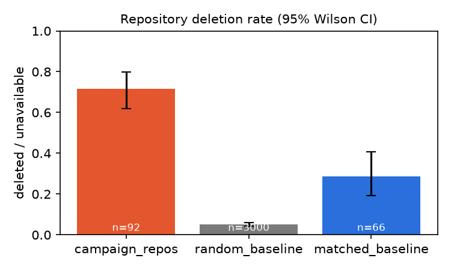
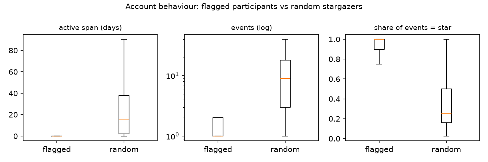
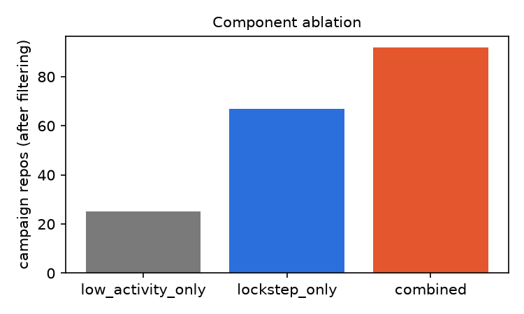
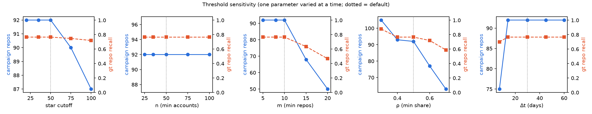

# Results: `synthetic_demo`

Window 2024-01-01 → 2024-03-31 · source `events` · thresholds n=50, m=10, ρ=0.5, Δt=30d, star cutoff=50

All figures below are aggregates. Flags are *suspected coordination*, not confirmed fraud.

## 1. Data quality

| step | count |
|---|---|
| raw_rows | 298303 |
| removed_missing_ids | 169 |
| removed_invalid_timestamp | 73 |
| removed_unexpected_type | 20 |
| rows_without_event_id | 308 |
| removed_duplicates | 26478 |
| clean_rows | 271563 |
| star_events | 66563 |
| restar_events_collapsed | 2411 |
| unique_star_edges | 64152 |
| unique_accounts | 22403 |
| unique_repositories | 6416 |
| profiled_accounts | 22403 |
| small_event_rows | 4205 |

## 2. Detection

| stage | stars | repos | accounts |
|---|---|---|---|
| low-activity signal | 5845 | 37 | 9132 |
| lockstep signal (CopyCatch) | 12471 |  |  |
| union before filtering | 18316 | 104 | 6809 |
| after filtering (campaigns) |  | 92 | 5479 |

Lockstep groups found: **4** · edges after pruning: 17505 of 64152 · runtime (s): low_activity 0.045, lockstep 0.106, filtering 0.037 · peak memory 481.5 MB

## 3. Evaluation

### 3.1 Known-campaign recall (Stargazers Ghost Network)

Coverage: 32/72 documented repos appear in the sample; 500/800 listed accounts; 1372 stargazers of documented repos.

| stage | repo_recall | listed_account_recall | stargazer_account_recall |
|---|---|---|---|
| before_filtering | 1.000 | 0.982 | 0.362 |
| after_filtering | 1.000 | 1.000 | 0.612 |

### 3.2 Deletion rate vs baselines (indirect signal)

| group | n_resolved | deleted | rate | diff_vs_random | diff_ci95 |
|---|---|---|---|---|---|
| campaign_repos | 92 | 66 | 0.717 | 0.667 | [0.567, 0.749] |
| random_baseline | 3000 | 152 | 0.051 | 0.000 | [-0.011, 0.011] |
| matched_baseline | 66 | 19 | 0.288 | 0.237 | [0.142, 0.356] |

Accounts:

| group | n_resolved | deleted | rate | diff_vs_random | diff_ci95 |
|---|---|---|---|---|---|
| flagged_participants | 1000 | 605 | 0.605 | 0.543 | [0.508, 0.576] |
| random_baseline | 1000 | 62 | 0.062 | 0.000 | [-0.021, 0.021] |

### 3.3 Behavioural profiling

3000 flagged participants vs 3000 random stargazers.

| feature | flagged_median | baseline_median | flagged_mean | baseline_mean | mannwhitney_p |
|---|---|---|---|---|---|
| active_days | 0.000 | 15.173 | 15.880 | 22.573 | 0.000 |
| n_events | 1.000 | 9.000 | 4.448 | 14.508 | 0.000 |
| n_starred_repos | 1.000 | 2.000 | 3.751 | 2.811 | 0.000 |
| star_share | 1.000 | 0.250 | 0.902 | 0.391 | 0.000 |
| share_push | 0.000 | 0.364 | 0.007 | 0.312 | 0.000 |
| share_fork | 0.000 | 0.000 | 0.071 | 0.035 | 0.000 |
| share_create | 0.000 | 0.038 | 0.018 | 0.073 | 0.000 |
| share_issues | 0.000 | 0.000 | 0.001 | 0.037 | 0.000 |
| share_pr | 0.000 | 0.000 | 0.001 | 0.065 | 0.000 |
| share_comment | 0.000 | 0.000 | 0.001 | 0.068 | 0.000 |

### 3.4 Component ablation

| variant | flagged_stars | campaign_repos | flagged_participants | known_repo_recall | known_stargazer_account_recall | deletion_diff | gt_repo_precision | gt_repo_recall | gt_account_precision | gt_account_recall |
|---|---|---|---|---|---|---|---|---|---|---|
| low_activity_only | 5845 | 25 | 3644 | 0.000 | 0.006 | 0.749 | 1.000 | 0.234 | 1.000 | 0.700 |
| lockstep_only | 12471 | 67 | 964 | 1.000 | 0.609 | 0.636 | 0.851 | 0.533 | 0.895 | 0.166 |
| combined | 18316 | 92 | 4608 | 1.000 | 0.612 | 0.667 | 0.891 | 0.766 | 0.978 | 0.866 |

### 3.5 Synthetic ground truth (implementation check only)

Repo precision 0.891, recall 0.766; account precision 0.978, recall 0.866.

Planted: `{'low_activity': 25, 'seller_2': 25, 'organic_community': 22, 'seller_0': 18, 'seller_3': 15, 'seller_1': 14, 'low_activity_small': 10, 'organic_viral': 2}`  
Retained: `{'seller_2': 25, 'low_activity': 25, 'seller_0': 18, 'seller_1': 14, 'organic_community': 10}`

## 4. Threshold sensitivity

| experiment | param | value | lockstep_groups | flagged_stars | campaign_repos | flagged_participants | known_repo_recall | deletion_diff | gt_repo_precision | gt_repo_recall | runtime_lockstep_s |
|---|---|---|---|---|---|---|---|---|---|---|---|
| default | - | - | 4 | 18316 | 92 | 4608 | 1.000 | 0.667 | 0.891 | 0.766 | 0.070 |
| one_at_a_time | star_cutoff | 20 | 4 | 19069 | 92 | 4608 | 1.000 | 0.667 | 0.891 | 0.766 | 0.070 |
| one_at_a_time | star_cutoff | 35 | 4 | 18557 | 92 | 4608 | 1.000 | 0.667 | 0.891 | 0.766 | 0.070 |
| one_at_a_time | star_cutoff | 75 | 4 | 17970 | 90 | 4480 | 1.000 | 0.660 | 0.889 | 0.748 | 0.070 |
| one_at_a_time | star_cutoff | 100 | 4 | 17622 | 87 | 4210 | 1.000 | 0.662 | 0.885 | 0.720 | 0.070 |
| one_at_a_time | n | 25 | 4 | 18316 | 92 | 4608 | 1.000 | 0.667 | 0.891 | 0.766 | 0.124 |
| one_at_a_time | n | 35 | 4 | 18316 | 92 | 4608 | 1.000 | 0.667 | 0.891 | 0.766 | 0.091 |
| one_at_a_time | n | 75 | 4 | 18316 | 92 | 4608 | 1.000 | 0.667 | 0.891 | 0.766 | 0.065 |
| one_at_a_time | n | 100 | 4 | 18311 | 92 | 4607 | 1.000 | 0.667 | 0.891 | 0.766 | 0.051 |
| one_at_a_time | m | 5 | 4 | 18316 | 92 | 4608 | 1.000 | 0.667 | 0.891 | 0.766 | 0.115 |
| one_at_a_time | m | 8 | 4 | 18316 | 92 | 4608 | 1.000 | 0.667 | 0.891 | 0.766 | 0.102 |
| one_at_a_time | m | 15 | 2 | 15573 | 68 | 4309 | 0.562 | 0.758 | 1.000 | 0.636 | 0.051 |
| one_at_a_time | m | 20 | 1 | 11900 | 50 | 4016 | 0.000 | 0.769 | 1.000 | 0.467 | 0.064 |
| one_at_a_time | rho | 0.3 | 5 | 19936 | 105 | 4846 | 1.000 | 0.683 | 0.895 | 0.879 | 0.298 |
| one_at_a_time | rho | 0.4 | 4 | 18802 | 93 | 4648 | 1.000 | 0.659 | 0.882 | 0.766 | 0.125 |
| one_at_a_time | rho | 0.6 | 3 | 15553 | 77 | 4397 | 1.000 | 0.755 | 1.000 | 0.720 | 0.074 |
| one_at_a_time | rho | 0.7 | 3 | 12695 | 63 | 4356 | 0.844 | 0.743 | 1.000 | 0.589 | 0.108 |
| one_at_a_time | delta_t_days | 7 | 3 | 15601 | 75 | 4483 | 0.938 | 0.736 | 1.000 | 0.701 | 0.072 |
| one_at_a_time | delta_t_days | 14 | 4 | 18332 | 92 | 4605 | 1.000 | 0.667 | 0.891 | 0.766 | 0.059 |
| one_at_a_time | delta_t_days | 45 | 4 | 18316 | 92 | 4608 | 1.000 | 0.667 | 0.891 | 0.766 | 0.099 |
| one_at_a_time | delta_t_days | 60 | 4 | 18316 | 92 | 4608 | 1.000 | 0.667 | 0.891 | 0.766 | 0.144 |
| combined | lenient | - | 6 | 20102 | 103 | 4804 | 1.000 | 0.687 | 0.893 | 0.860 | 0.317 |
| combined | strict | - | 2 | 13381 | 61 | 4102 | 0.562 | 0.769 | 1.000 | 0.570 | 0.075 |

